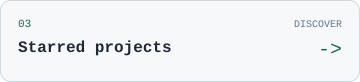

<picture>
  <source media="(prefers-color-scheme: dark)" srcset="./assets/profile-dark.svg">
  
</picture>

  <a href="https://github.com/chenyiwen-work?tab=repositories"><picture><source media="(prefers-color-scheme: dark)" srcset="./assets/repositories-dark.svg"></picture></a>
  <a href="https://github.com/chenyiwen-work?tab=overview"><picture><source media="(prefers-color-scheme: dark)" srcset="./assets/activity-dark.svg"></picture></a>
  <a href="https://github.com/chenyiwen-work?tab=stars"><picture><source media="(prefers-color-scheme: dark)" srcset="./assets/stars-dark.svg"></picture></a>

<picture>
  <source media="(prefers-color-scheme: dark)" srcset="./assets/pacman-dark.svg">
  
</picture>

<code>$ ls public-forks/</code>

A few projects I am exploring through public forks. Credit belongs to their original authors.

| Project | Area |
| :--- | :--- |
| [axonhub](https://github.com/chenyiwen-work/axonhub) | AI model gateways, routing and observability |
| [AgentENV](https://github.com/chenyiwen-work/AgentENV) | Distributed agent environments |
| [jianying-headless](https://github.com/chenyiwen-work/jianying-headless) | Programmatic video editing and agent workflows |
| [marimo](https://github.com/chenyiwen-work/marimo) | Reactive Python notebooks |

